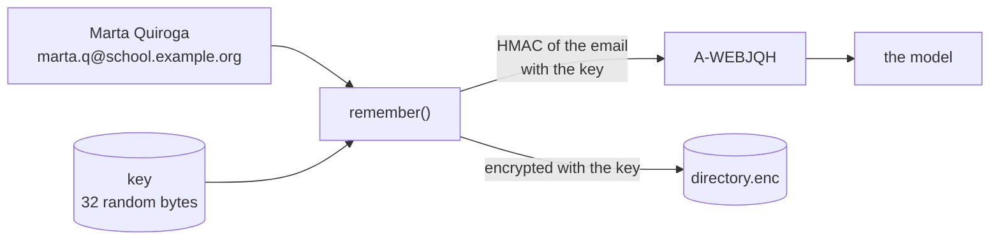
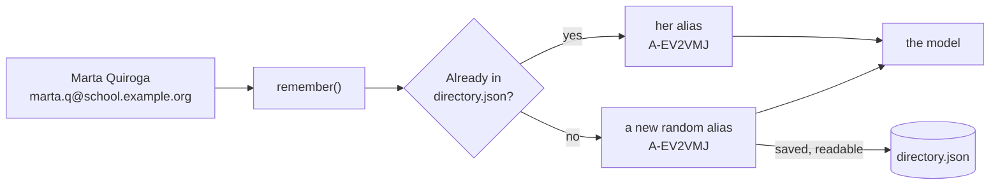
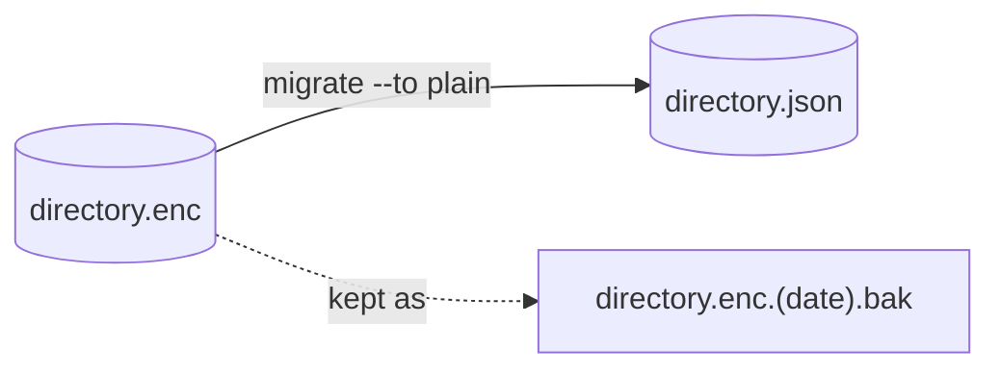

# Storage: encrypted or plain

pseudonym remembers who each alias is in a file called the **directory**, inside its folder (`%APPDATA%\pseudonym\` on Windows, `~/.config/pseudonym/` elsewhere, or `PSEUDONYM_HOME`). That file can be kept in two ways:

- **Encrypted** (the default): locked with a key, like a safe. Without the key, the file is unreadable noise.
- **Plain**: an ordinary, readable JSON file, with no key at all. What protects it is your computer: who is allowed to open the folder.

What the model receives is exactly the same in both: aliases such as `A-WEBJQH` and placeholders such as `[EMAIL_1]`. The only difference is **what someone who opens the folder can read**.

## In short

| What | Encrypted (default) | Plain |
| --- | --- | --- |
| The directory | `directory.enc`, unreadable | `directory.json`, readable |
| Key | Yes: `key` (and the `used` marker) | None |
| How aliases are made | Computed from the person's identifier with the key | Drawn at random, then stored |
| Same person after `forget` | Gets the same alias back | Gets a new alias |
| Emails and ids on disk | Never: only keyed fingerprints of them | In clear |
| What protects the data | The key, plus the folder's permissions | Only the folder's permissions |
| Back up | The key (once) and, if you want, the directory | The directory |

## Encrypted storage (the default)


Think of a **safe and its key**. The list of who is who goes into the safe (`directory.enc`); the key (`key`) is kept apart. Anyone can see the safe, but only whoever holds the key can open it. The same key also *makes* the aliases: it mixes with each person's email or id to give a code that is always the same for that person and can't be undone without the key.

### What happens when your program remembers someone



1. The first time any program uses pseudonym, it creates the **key**: 32 random bytes.
2. `remember()` combines the person's strongest identifier (here, the email) with the key (an [HMAC](https://www.rfc-editor.org/rfc/rfc2104)): `A-WEBJQH`. Same person, same key: same alias, always.
3. The person's name, service id and *fingerprints* of their email and id are added to the directory, which is then encrypted with the key and saved.
4. Only `A-WEBJQH` goes to the model.

### What's in the folder

Real files from a test folder after remembering two people:

**`key`**: 32 random bytes. Everything depends on it. `pseudonym key export` shows it as text:

```text
cxf+pDJEwqE3LfsGWZ9KCBUt51Z64/6fJ8fn5d1N+/A=
```

**`used`**: an empty file (0 bytes). It only says "a key was created here". If one day `key` disappears but `used` is still there, pseudonym knows the key was lost, stops, and asks you to restore it, instead of silently creating a new key that would change every alias.

**`directory.enc`**: the directory, encrypted (633 bytes for two people). Its first bytes say what it is; the rest is unreadable without the key:

```text
50534555444f4e594d2d444952454354  PSEUDONYM-DIRECT
4f525901f05c9107bd3de7d332f2603b  ORY.ð\..½=çÓ2ò`;
be0e171254666cbbcfa9e58871d46776  ¾...Tfl»Ï©å.qÔgv
...
```

Once decrypted with the key, each person looks like this. The emails and ids are not there, only their keyed fingerprints (*matchers*), which recognize Marta if she comes back but can't be turned back into her email:

```json
{
  "alias": "A-WEBJQH",
  "displayName": "Marta Quiroga",
  "services": [{ "service": "moodle@campus.example.org", "id": "4821" }],
  "matchers": ["-qv-Gj55cgoww5nfPQzfua6P3qGmXYwqUVjpsFFqKtA", "p8T6nRDl4s59DS0tbwb2jErtEvK8kKSMZLiZCXi0YpE"],
  "links": [],
  "firstSeen": "2026-10-27T19:42:54.765Z",
  "lastSeen": "2026-10-27T19:42:54.765Z"
}
```

**`directory.lock`**: appears for a few milliseconds while a program is writing the directory, so two programs never write at once. It holds the writing process's number.

### Advantages and drawbacks

- ✅ **A copied folder reveals nothing without the key**: the directory is noise, and the aliases can't be undone.
- ✅ **Emails and ids are never on disk**, not even inside the encrypted file.
- ✅ **Aliases are recomputable**: forget someone and meet them again, and they get the same alias.
- ⚠️ **The key must be backed up** (`pseudonym key export`, once). Lose it and every way back is lost, by design.
- ⚠️ **You can't read or fix the directory by hand**; only through pseudonym.

## Plain storage


Think of **an open binder in a locked room**. The list of who is who is an ordinary JSON file you can open in any editor; there is no key at all. What keeps it safe is the room: the operating system's permissions on the folder (only your user can read it) and, ideally, a machine or account nothing else uses.

### What happens when your program remembers someone



1. There is no key: nothing is created but `directory.json`.
2. `remember()` looks the person up in the file by their email, id or service id. If she's there, it returns her alias.
3. If not, it draws a **random** alias (`A-EV2VMJ`) and writes the person, with her email and id in clear, to `directory.json`.
4. Only `A-EV2VMJ` goes to the model.

Because the alias is random, it only exists in the file: forget the person and meet her again, and she gets a new one.

### What's in the folder

Just **`directory.json`** (and `directory.lock` for a few milliseconds while writing). The real file after remembering the same two people:

```json
{
  "format": "pseudonym-directory",
  "version": 1,
  "entries": [
    {
      "alias": "A-EV2VMJ",
      "displayName": "Marta Quiroga",
      "services": [{ "service": "moodle@campus.example.org", "id": "4821" }],
      "matchers": ["institutionalId:20240031", "email:marta.q@school.example.org"],
      "links": [],
      "firstSeen": "2026-10-27T19:42:42.454Z",
      "lastSeen": "2026-10-27T19:42:42.454Z"
    },
    {
      "alias": "A-FBXET2",
      "displayName": "Hugo Estrella",
      "services": [{ "service": "moodle@campus.example.org", "id": "4822" }],
      "matchers": ["email:hugo.e@school.example.org"],
      "links": [],
      "firstSeen": "2026-10-27T19:42:42.454Z",
      "lastSeen": "2026-10-27T19:42:42.454Z"
    }
  ]
}
```

Compare `matchers` with the encrypted example: here they are the email and id themselves.

### Advantages and drawbacks

- ✅ **No key to create, back up or lose.** Backing up the directory is copying one file.
- ✅ **Readable**: you can open it, check it, search it, or fix a name by hand (with no program running).
- ✅ **Fits setups where the system already protects the folder**: a dedicated user account, a container, an encrypted disk on a machine only you use.
- ⚠️ **Names, emails and ids are on disk in clear.** Whoever can read the folder (another user, a backup, a synced folder, an agent) can undo every alias.
- ⚠️ **Aliases aren't recomputable**: forgotten and met again, a person gets a new alias.

## The same person in both modes

| Who | Encrypted | Plain |
| --- | --- | --- |
| The model sees | `A-WEBJQH` | `A-EV2VMJ` |
| Someone who copies the folder sees | Noise, and a key file next to it | `"Marta Quiroga"`, `"email:marta.q@school.example.org"` |
| You, with `pseudonym whois` | Marta Quiroga | Marta Quiroga |

## When to choose plain

Only when the folder is already protected by something else, and you prefer readable data to a key you have to keep:

- the program runs under its own user account, or in a container, and nothing else can read its files;
- you need to inspect or fix the directory by hand, or back it up with the rest of your data;
- you don't want to manage a key on that machine.

If an agent, another user or a synced folder can read it, keep the default.

## Choosing the mode

In code, before the first call:

```ts
import { configure } from "@falkenslab/pseudonym";

configure({ storage: "plain" });
```

Or with an environment variable, which the [CLI](../cli/overview.md) reads too:

```bash
export PSEUDONYM_STORAGE=plain        # sh
```

```powershell
$env:PSEUDONYM_STORAGE = "plain"      # PowerShell
```

`configure()` wins over the variable; without either, the storage is `encrypted`. `storageMode()` says which one is in use. Every program sharing the folder, and the CLI, must use the same mode.

## It never switches by itself

If the folder holds the other mode's directory, every call fails with a `PseudonymError` that says what to do, and nothing is changed: a plain `directory.json` is never read as encrypted, an encrypted `directory.enc` is never replaced by a plain one, and a missing or wrong key never makes the library fall back to plain storage. A folder with both files is an error too.

## The JSON format

- `format` and `version`: say it's a pseudonym directory, and which version of the format. A version newer than the library knows is refused, not guessed.
- `alias`: what the model sees.
- `displayName`: what `pseudonym whois` shows.
- `services`: where the person was met, with the `serviceUserId` that [`resolve()`](integrating.md#3-take-aliases-back-with-resolve) gives back.
- `matchers`: the [normalized](concepts.md#identifiers) identifiers that recognize the person, as `kind:value`.
- `links`: aliases [linked](../cli/tidying-the-directory.md#link-two-aliases) into this one.
- `firstSeen`, `lastSeen`: when a program first and last remembered the person (used by `pseudonym prune`).

The file is written whole through a temporary file and a rename, under the same lock as the encrypted one, and readable by its user only (`0600` on macOS and Linux; on Windows, `%APPDATA%` is already per user). Edit it by hand only while no program is using the folder.

## Converting a directory

`pseudonym migrate` converts the directory in the folder to the other mode, with the same aliases:

```bash
pseudonym migrate --to plain        # directory.enc → directory.json
pseudonym migrate --to encrypted    # directory.json → directory.enc (with PSEUDONYM_STORAGE=plain set)
```



- It asks you to type the mode to confirm (`--yes` in a script), writes the new file, and moves the original aside to `<file>.<date>.bak`: nothing is deleted.
- It refuses if there's nothing to convert, or if the target file already exists.
- Then set `PSEUDONYM_STORAGE` to the new mode for every program and the CLI.
- **Going to plain**, emails and institutional ids can't come along: the encrypted directory only has their keyed fingerprints, which can't be reversed. People are still recognized by their service ids; the command says how many have none and will get a new alias if they're met again.
- Going to encrypted, everything comes along: the identifiers in clear become keyed fingerprints under the key (created if there was none).

## What it means for privacy

Plain storage is a choice to store personal data unencrypted. Under the [GDPR](../security/gdpr.md), the directory is still pseudonymization's "additional information" and must be "kept separately and protected": in plain mode, the folder's permissions and isolation are that protection, and they're yours to ensure. [Keep agents away](../security/keeping-agents-away.md) from the folder as you would from the key: with plain storage, reading `directory.json` is enough to undo every alias.
