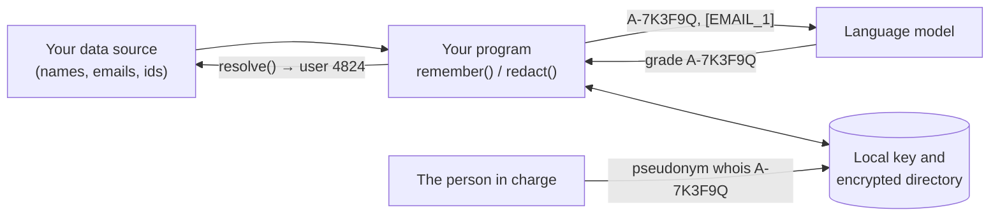

# Introduction

`@falkenslab/pseudonym` gives people stable aliases, so a program can tell a language model about them without names, emails or ids, while the person running that program can always find out who is who on their own machine.

A program that sends data about people to a model (an [MCP](https://modelcontextprotocol.io) server reading a course's submissions, say) passes each person through the library and sends `A-7K3F9Q` instead of "Lucía Ferrándiz". The model can still tell people apart, refer to them, and ask your program to act on them ("grade A-7K3F9Q"); it just never learns who they are.

## How it works, in one picture

- **The alias** is an [HMAC](https://www.rfc-editor.org/rfc/rfc2104) of the person's best identifier under a key that never leaves the machine: always the same for the same person, impossible to undo without the key.
- **The directory** is a local encrypted file that remembers who each alias is: it keeps a person's first alias when their email changes, and lets the person in charge resolve aliases offline.
- **One key and one directory per user**, shared by every program on the machine that uses the library.
- **Free text** (a submission, a forum post) can be redacted too: known people become their aliases, and emails, payment cards, IBANs and the national ids and phones of the countries you choose become placeholders.

## What it isn't

- **Not anonymization.** It's [pseudonymization](https://en.wikipedia.org/wiki/Pseudonymization): the data stays personal data for whoever holds the key, and what people write about themselves can still identify them. See [Security and privacy](security/threat-model.md).
- **Not a detector.** Your code says which fields are people; the library doesn't search structured data for them. In free text it finds only the directory's people and a few checked patterns.
- **Not a server.** It runs inside your program. There is no tool an agent could call to undo it.

## Where to go next

- Integrating it in a program: [Installation](guides/installation.md), then [Integrating it](guides/integrating.md).
- Seeing it working: [the classroom MCP example](example/classroom-mcp.md).
- Running a program that uses it: [the CLI](cli/overview.md).
- Deciding whether it's safe enough for your data: [Security and privacy](security/threat-model.md).
