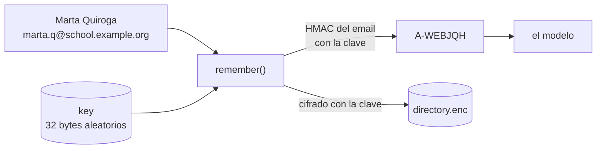
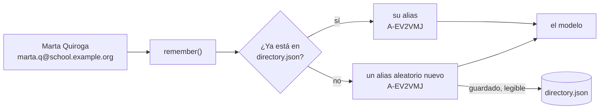
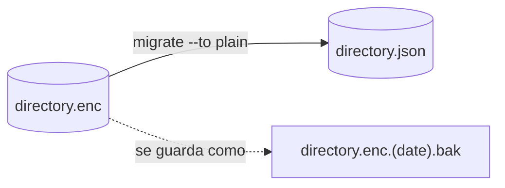

# Almacenamiento: cifrado o plano {#storage-encrypted-or-plain}

pseudonym recuerda quién es cada alias en un fichero llamado **directorio**, dentro de su carpeta (`%APPDATA%\pseudonym\` en Windows, `~/.config/pseudonym/` en los demás sistemas, o `PSEUDONYM_HOME`). Ese fichero se puede guardar de dos maneras:

- **Cifrado** (la opción por defecto): cerrado con una clave, como una caja fuerte. Sin la clave, el fichero es ruido ilegible.
- **Plano**: un fichero JSON normal y legible, sin ninguna clave. Lo que lo protege es tu equipo: quién tiene permiso para abrir la carpeta.

Lo que recibe el modelo es exactamente lo mismo en los dos: alias como `A-WEBJQH` y marcadores como `[EMAIL_1]`. La única diferencia es **lo que puede leer alguien que abra la carpeta**.

## En resumen {#in-short}

| Qué | Cifrado (por defecto) | Plano |
| --- | --- | --- |
| El directorio | `directory.enc`, ilegible | `directory.json`, legible |
| Clave | Sí: `key` (y el marcador `used`) | Ninguna |
| Cómo se crean los alias | Se calculan a partir del identificador de la persona con la clave | Se sacan al azar y luego se guardan |
| La misma persona después de `forget` | Vuelve a recibir el mismo alias | Recibe un alias nuevo |
| Correos e ids en disco | Nunca: solo sus huellas con clave | En claro |
| Qué protege los datos | La clave, más los permisos de la carpeta | Solo los permisos de la carpeta |
| Copia de seguridad | La clave (una vez) y, si quieres, el directorio | El directorio |

## Almacenamiento cifrado (por defecto) {#encrypted-storage-the-default}


Piensa en **una caja fuerte y su llave**. La lista de quién es quién va dentro de la caja fuerte (`directory.enc`); la clave (`key`) se guarda aparte. Cualquiera puede ver la caja fuerte, pero solo quien tiene la clave puede abrirla. La misma clave también *fabrica* los alias: se mezcla con el correo o el id de cada persona para dar un código que siempre es el mismo para esa persona y que no se puede deshacer sin la clave.

### Qué pasa cuando tu programa recuerda a alguien {#what-happens-when-your-program-remembers-someone}



1. La primera vez que un programa usa pseudonym, crea la **clave**: 32 bytes aleatorios.
2. `remember()` combina el identificador más fuerte de la persona (aquí, el correo) con la clave (un [HMAC](https://www.rfc-editor.org/rfc/rfc2104)): `A-WEBJQH`. Misma persona, misma clave: mismo alias, siempre.
3. El nombre de la persona, su id de servicio y las *huellas* de su correo y de su id se añaden al directorio, que después se cifra con la clave y se guarda.
4. Al modelo solo le llega `A-WEBJQH`.

### Qué hay en la carpeta {#whats-in-the-folder}

Ficheros reales de una carpeta de prueba después de recordar a dos personas:

**`key`**: 32 bytes aleatorios. Todo depende de ella. `pseudonym key export` la muestra como texto:

```text
cxf+pDJEwqE3LfsGWZ9KCBUt51Z64/6fJ8fn5d1N+/A=
```

**`used`**: un fichero vacío (0 bytes). Solo dice «aquí se creó una clave». Si un día desaparece `key` pero `used` sigue ahí, pseudonym sabe que la clave se ha perdido, se detiene y te pide que la restaures, en lugar de crear sin avisar una clave nueva que cambiaría todos los alias.

**`directory.enc`**: el directorio, cifrado (633 bytes para dos personas). Sus primeros bytes dicen qué es; el resto es ilegible sin la clave:

```text
50534555444f4e594d2d444952454354  PSEUDONYM-DIRECT
4f525901f05c9107bd3de7d332f2603b  ORY.ð\..½=çÓ2ò`;
be0e171254666cbbcfa9e58871d46776  ¾...Tfl»Ï©å.qÔgv
...
```

Una vez descifrado con la clave, cada persona tiene este aspecto. Los correos y los ids no están, solo sus huellas con clave (*matchers*), que reconocen a Marta si vuelve pero no se pueden convertir de nuevo en su correo:

```json
{
  "alias": "A-WEBJQH",
  "displayName": "Marta Quiroga",
  "services": [{ "service": "moodle@campus.example.org", "id": "4821" }],
  "matchers": ["-qv-Gj55cgoww5nfPQzfua6P3qGmXYwqUVjpsFFqKtA", "p8T6nRDl4s59DS0tbwb2jErtEvK8kKSMZLiZCXi0YpE"],
  "links": [],
  "firstSeen": "2026-10-27T19:42:54.765Z",
  "lastSeen": "2026-10-27T19:42:54.765Z"
}
```

**`directory.lock`**: aparece durante unos milisegundos mientras un programa escribe el directorio, para que nunca escriban dos programas a la vez. Contiene el número del proceso que escribe.

### Ventajas e inconvenientes {#advantages-and-drawbacks}

- ✅ **Una carpeta copiada no revela nada sin la clave**: el directorio es ruido, y los alias no se pueden deshacer.
- ✅ **Los correos y los ids nunca están en disco**, ni siquiera dentro del fichero cifrado.
- ✅ **Los alias se pueden volver a calcular**: si olvidas a alguien y lo vuelves a encontrar, recibe el mismo alias.
- ⚠️ **Hay que hacer copia de seguridad de la clave** (`pseudonym key export`, una vez). Si la pierdes, pierdes cualquier camino de vuelta, por diseño.
- ⚠️ **No puedes leer ni corregir el directorio a mano**; solo a través de pseudonym.

## Almacenamiento plano {#plain-storage}


Piensa en **una carpeta abierta en una habitación cerrada con llave**. La lista de quién es quién es un fichero JSON normal que puedes abrir con cualquier editor; no hay ninguna clave. Lo que lo mantiene a salvo es la habitación: los permisos del sistema operativo sobre la carpeta (solo tu usuario puede leerla) y, a ser posible, una máquina o una cuenta que no use nada más.

### Qué pasa cuando tu programa recuerda a alguien {#what-happens-when-your-program-remembers-someone-1}



1. No hay clave: no se crea nada más que `directory.json`.
2. `remember()` busca a la persona en el fichero por su correo, su id o su id de servicio. Si está, devuelve su alias.
3. Si no, saca un alias **aleatorio** (`A-EV2VMJ`) y escribe a la persona, con su correo y su id en claro, en `directory.json`.
4. Al modelo solo le llega `A-EV2VMJ`.

Como el alias es aleatorio, solo existe en el fichero: si olvidas a la persona y la vuelves a encontrar, recibe uno nuevo.

### Qué hay en la carpeta {#whats-in-the-folder-1}

Solo **`directory.json`** (y `directory.lock` durante unos milisegundos mientras se escribe). El fichero real después de recordar a las mismas dos personas:

```json
{
  "format": "pseudonym-directory",
  "version": 1,
  "entries": [
    {
      "alias": "A-EV2VMJ",
      "displayName": "Marta Quiroga",
      "services": [{ "service": "moodle@campus.example.org", "id": "4821" }],
      "matchers": ["institutionalId:20240031", "email:marta.q@school.example.org"],
      "links": [],
      "firstSeen": "2026-10-27T19:42:42.454Z",
      "lastSeen": "2026-10-27T19:42:42.454Z"
    },
    {
      "alias": "A-FBXET2",
      "displayName": "Hugo Estrella",
      "services": [{ "service": "moodle@campus.example.org", "id": "4822" }],
      "matchers": ["email:hugo.e@school.example.org"],
      "links": [],
      "firstSeen": "2026-10-27T19:42:42.454Z",
      "lastSeen": "2026-10-27T19:42:42.454Z"
    }
  ]
}
```

Compara `matchers` con el ejemplo cifrado: aquí son el propio correo y el propio id.

### Ventajas e inconvenientes {#advantages-and-drawbacks-1}

- ✅ **No hay clave que crear, guardar en una copia de seguridad o perder.** Hacer copia de seguridad del directorio es copiar un fichero.
- ✅ **Legible**: puedes abrirlo, revisarlo, buscar en él o corregir un nombre a mano (sin ningún programa en marcha).
- ✅ **Encaja en entornos en los que el sistema ya protege la carpeta**: una cuenta de usuario dedicada, un contenedor, un disco cifrado en una máquina que solo usas tú.
- ⚠️ **Los nombres, correos e ids están en disco en claro.** Quien pueda leer la carpeta (otro usuario, una copia de seguridad, una carpeta sincronizada, un agente) puede deshacer todos los alias.
- ⚠️ **Los alias no se pueden volver a calcular**: si se olvida a una persona y se la vuelve a encontrar, recibe un alias nuevo.

## La misma persona en los dos modos {#the-same-person-in-both-modes}

| Quién | Cifrado | Plano |
| --- | --- | --- |
| El modelo ve | `A-WEBJQH` | `A-EV2VMJ` |
| Alguien que copia la carpeta ve | Ruido, y un fichero de clave al lado | `"Marta Quiroga"`, `"email:marta.q@school.example.org"` |
| Tú, con `pseudonym whois` | Marta Quiroga | Marta Quiroga |

## Cuándo elegir plano {#when-to-choose-plain}

Solo cuando la carpeta ya está protegida por otra cosa y prefieres datos legibles a una clave que tienes que guardar:

- el programa se ejecuta con su propia cuenta de usuario, o en un contenedor, y nada más puede leer sus ficheros;
- necesitas revisar o corregir el directorio a mano, o hacer su copia de seguridad junto con el resto de tus datos;
- no quieres gestionar una clave en esa máquina.

Si un agente, otro usuario o una carpeta sincronizada pueden leerla, quédate con la opción por defecto.

## Elegir el modo {#choosing-the-mode}

En código, antes de la primera llamada:

```ts
import { configure } from "@falkenslab/pseudonym";

configure({ storage: "plain" });
```

O con una variable de entorno, que también lee la [CLI](../cli/overview.md):

```bash
export PSEUDONYM_STORAGE=plain        # sh
```

```powershell
$env:PSEUDONYM_STORAGE = "plain"      # PowerShell
```

`configure()` tiene prioridad sobre la variable; sin ninguna de las dos, el almacenamiento es `encrypted`. `storageMode()` indica cuál está en uso. Todos los programas que comparten la carpeta, y la CLI, deben usar el mismo modo.

## Nunca cambia por sí solo {#it-never-switches-by-itself}

Si la carpeta contiene el directorio del otro modo, todas las llamadas fallan con un `PseudonymError` que dice qué hacer, y no se cambia nada: un `directory.json` plano nunca se lee como cifrado, un `directory.enc` cifrado nunca se sustituye por uno plano, y una clave ausente o incorrecta nunca hace que la librería recurra al almacenamiento plano. Una carpeta con los dos ficheros también es un error.

## El formato JSON {#the-json-format}

- `format` y `version`: dicen que es un directorio de pseudonym y qué versión del formato tiene. Una versión más reciente de la que conoce la librería se rechaza, no se adivina.
- `alias`: lo que ve el modelo.
- `displayName`: lo que muestra `pseudonym whois`.
- `services`: dónde se conoció a la persona, con el `serviceUserId` que devuelve [`resolve()`](integrating.md#3-take-aliases-back-with-resolve).
- `matchers`: los identificadores [normalizados](concepts.md#identifiers) que reconocen a la persona, como `kind:value`.
- `links`: alias [enlazados](../cli/tidying-the-directory.md#link-two-aliases) con este.
- `firstSeen`, `lastSeen`: cuándo un programa recordó a la persona por primera y por última vez (lo usa `pseudonym prune`).

El fichero se escribe entero mediante un fichero temporal y un renombrado, con el mismo bloqueo que el cifrado, y solo su usuario puede leerlo (`0600` en macOS y Linux; en Windows, `%APPDATA%` ya es por usuario). Edítalo a mano solo mientras ningún programa esté usando la carpeta.

## Convertir un directorio {#converting-a-directory}

`pseudonym migrate` convierte el directorio de la carpeta al otro modo, con los mismos alias:

```bash
pseudonym migrate --to plain        # directory.enc → directory.json
pseudonym migrate --to encrypted    # directory.json → directory.enc (with PSEUDONYM_STORAGE=plain set)
```



- Te pide que escribas el modo para confirmar (`--yes` en un script), escribe el fichero nuevo y aparta el original como `<file>.<date>.bak`: no se borra nada.
- Se niega si no hay nada que convertir, o si el fichero de destino ya existe.
- Después, establece `PSEUDONYM_STORAGE` al nuevo modo para todos los programas y la CLI.
- **Al pasar a plano**, los correos y los identificadores institucionales no se pueden llevar: el directorio cifrado solo tiene sus huellas con clave, que no se pueden revertir. Las personas se siguen reconociendo por sus ids de servicio; el comando indica cuántas no tienen ninguno y recibirán un alias nuevo si se las vuelve a encontrar.
- Al pasar a cifrado, se lleva todo: los identificadores en claro se convierten en huellas con clave bajo la clave (que se crea si no había ninguna).

## Qué supone para la privacidad {#what-it-means-for-privacy}

El almacenamiento plano es la decisión de guardar datos personales sin cifrar. Según el [RGPD](../security/gdpr.md), el directorio sigue siendo la «información adicional» de la seudonimización y debe estar «conservada por separado y protegida»: en modo plano, esa protección son los permisos y el aislamiento de la carpeta, y garantizarlos te corresponde a ti. [Mantén a los agentes alejados](../security/keeping-agents-away.md) de la carpeta igual que de la clave: con almacenamiento plano, leer `directory.json` basta para deshacer todos los alias.
