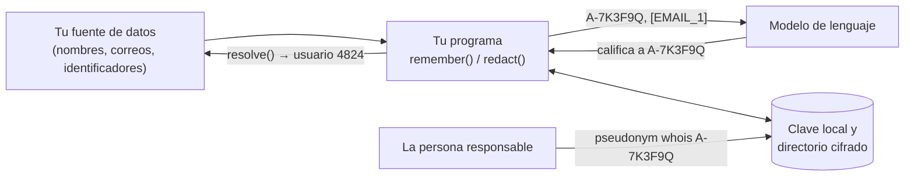

# Introducción {#introduction}

`@falkenslab/pseudonym` da a las personas alias estables, para que un programa pueda hablarle de ellas a un modelo de lenguaje sin nombres, correos ni identificadores, mientras la persona que ejecuta ese programa siempre puede averiguar quién es quién en su propio equipo.

Un programa que envía datos de personas a un modelo (por ejemplo, un servidor [MCP](https://modelcontextprotocol.io) que lee las entregas de un curso) pasa a cada persona por la librería y envía `A-7K3F9Q` en lugar de "Lucía Ferrándiz". El modelo sigue pudiendo distinguir a las personas, referirse a ellas y pedirle a tu programa que actúe sobre ellas ("califica a A-7K3F9Q"); simplemente nunca sabe quiénes son.

## Cómo funciona, en una imagen {#how-it-works-in-one-picture}

- **El alias** es un [HMAC](https://www.rfc-editor.org/rfc/rfc2104) del mejor identificador de la persona con una clave que nunca sale del equipo: siempre el mismo para la misma persona, imposible de deshacer sin la clave.
- **El directorio** es un fichero local cifrado que recuerda quién es cada alias: conserva el primer alias de una persona cuando cambia su correo y permite a la persona responsable resolver alias sin conexión.
- **Una clave y un directorio por usuario**, compartidos por todos los programas del equipo que usan la librería.
- **El texto libre** (una entrega, un mensaje de un foro) también se puede redactar: las personas conocidas pasan a ser sus alias, y los correos, tarjetas de pago, IBAN y los documentos nacionales y teléfonos de los países que elijas pasan a ser marcadores.

## Lo que no es {#what-it-isnt}

- **No es anonimización.** Es [seudonimización](https://en.wikipedia.org/wiki/Pseudonymization): los datos siguen siendo datos personales para quien tiene la clave, y lo que la gente escribe sobre sí misma aún puede identificarla. Consulta [Seguridad y privacidad](security/threat-model.md).
- **No es un detector.** Tu código dice qué campos son personas; la librería no las busca en datos estructurados. En texto libre solo encuentra a las personas del directorio y unos pocos patrones verificados.
- **No es un servidor.** Se ejecuta dentro de tu programa. No hay ninguna herramienta que un agente pueda llamar para deshacerla.

## Por dónde seguir {#where-to-go-next}

- Para integrarla en un programa: [Instalación](guides/installation.md) y después [Integración](guides/integrating.md).
- Para verla funcionando: [el ejemplo MCP del aula](example/classroom-mcp.md).
- Para ejecutar un programa que la usa: [la CLI](cli/overview.md).
- Para decidir si es lo bastante segura para tus datos: [Seguridad y privacidad](security/threat-model.md).
